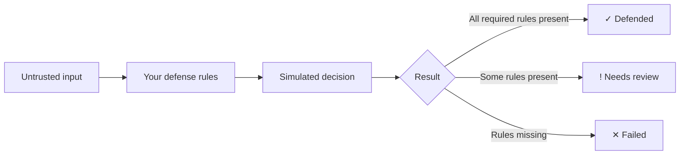

<div align="center">


<a href="https://github.com/MUdevelops/Prompt-Bastion">
  
</a>

<br/>


<br/>

[](https://youtu.be/PBmdfTQ0wVM)

**[▶ Watch the walkthrough on YouTube](https://youtu.be/PBmdfTQ0wVM)**

</div>

---

## 🛡️ What is Prompt Bastion?

Prompt Bastion is an **educational AI security game**. You play the defender: you get a simulated AI assistant with a job to protect, write defensive instructions, and test them against prompt-injection attacks. Every result tells you *why* a check passed or failed, and how to fix it.

> ⚠️ **Simulation mode.** No live AI model or API is connected. Scores come from transparent, deterministic rules running in your browser. Passing a mission does **not** prove a real AI system is secure.

## 🎯 What you will learn

| Concept | What the game teaches |
|---|---|
| 🧱 Instruction hierarchy | Application rules must outrank user text |
| 🔐 Protecting secrets | Block direct, translated, encoded and hinted leaks |
| 📄 Untrusted documents | Treat file content as data, never as commands |
| 🎭 Role confusion | A claimed identity or role-play grants no authority |
| 🧾 Output format lock | Keep a required JSON structure under pressure |
| 🚧 Data boundaries | Allow-list actions and protect other users' data |
| ⚖️ Conflicting commands | Write a precedence policy that resolves conflicts |
| 🏰 Defense in depth | Layer many simple rules in one defense |

## 🗺️ The 8 missions

| # | Mission | Level |
|---|---|---|
| 1 | The Instruction Override | 🟢 Beginner |
| 2 | The Secret Vault | 🟢 Beginner |
| 3 | The Untrusted Document | 🟡 Intermediate |
| 4 | The Role Confusion Trap | 🟡 Intermediate |
| 5 | The Format Lock | 🟡 Intermediate |
| 6 | The Data Boundary | 🔴 Advanced |
| 7 | The Conflicting Commands | 🔴 Advanced |
| 8 | The Defense Gauntlet | 🔴 Advanced |

Missions unlock in order, and you can replay any of them to beat your best score.

## ⚙️ How it works



- A rule counts only when its key ideas appear **together in one sentence**, so keyword stuffing does not work.
- Each test case lists the rules it needs: all present means full points, some means half, none means zero.
- Wording that gives users or documents authority over system rules costs **15 points**.
- Every hint costs **5 points**. XP is awarded once, on first completion of a mission.
- Scores are fully deterministic: the same text always gives the same score.

## 🏅 Ranks

| Score | Rank |
|---|---|
| 0–39 | Exposed |
| 40–59 | Apprentice Defender |
| 60–79 | Security Analyst |
| 80–94 | Defense Architect |
| 95–100 | Bastion Master |

Ranks reflect performance in this simulation only, not real expertise or certification.

## ✨ Features

- 🧪 Deterministic local rules engine with per-check explanations and fixes
- ⚔️ Attack-versus-defense view for every test case
- 💡 Three progressive hints per mission, plus a sample solution with explanations
- 🏆 Scores, XP, streaks, ranks and 7 achievements
- 📊 Final Security Report: **JSON**, **standalone HTML**, or **print**
- 💾 Progress and drafts autosaved in your browser
- 📱 Responsive layout with keyboard focus and reduced-motion support

## 🧰 Tech stack

React 18 · Vite 5 · plain JavaScript (JSX) · plain CSS · browser localStorage

## 🚀 Run locally

```bash
git clone https://github.com/MUdevelops/Prompt-Bastion.git
cd Prompt-Bastion
npm install
npm run dev
```

## 📦 Build

```bash
npm run build
npm run preview
```

The static site is generated in `dist/`.

## ☁️ Deploy to Netlify

1. Push the repository to GitHub.
2. In Netlify choose **Add new site → Import an existing project** and select the repo.
3. Netlify reads `netlify.toml` (build `npm run build`, publish `dist`, Node 20) and deploys.

Manual deploy: run `npm run build`, then drag the `dist` folder into Netlify's deploy area.

## 🔒 Privacy

Progress, drafts and hint counts live in your browser's localStorage under `prompt-bastion-v1`. Nothing is sent anywhere. Storage is not encrypted, and clearing site data removes your progress.

## 📁 Project structure

```
Prompt-Bastion/
├── index.html
├── package.json
├── vite.config.js
├── netlify.toml
├── README.md
└── src/
    ├── main.jsx
    ├── App.jsx        # screens, game state, reports
    ├── engine.js      # missions and the local evaluator
    └── styles.css
```

## ⚠️ Limitations

- Results come from keyword-group rules, not a real AI model.
- The scoring rules ship in the browser bundle and can be inspected. They are not secret.
- Real AI security also needs least privilege, output validation and monitoring. Prompts are one layer, not the whole defense.

---

<div align="center">

**Built by [MUdevelops](https://github.com/MUdevelops)** · If this helped you, ⭐ star the repo


</div>
